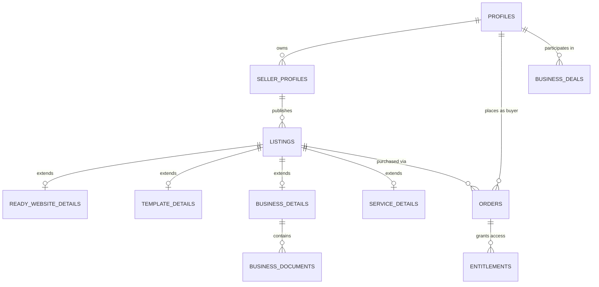

# WebBazaar — Database Architecture & Schema Specification

WebBazaar utilizes PostgreSQL (via Supabase) with Row-Level Security (RLS), UUID primary keys, check constraints, and immutable audit logs.

---

## 1. Entity-Relationship Overview

---

## 2. Core Tables Specification (Prepared for Phase 2 Migration)

### `profiles`
- `id` (UUID, PK, references `auth.users`)
- `email` (TEXT, UNIQUE, NOT NULL)
- `full_name` (TEXT, NOT NULL)
- `avatar_url` (TEXT)
- `phone` (TEXT)
- `created_at` (TIMESTAMPTZ, DEFAULT NOW())
- `updated_at` (TIMESTAMPTZ, DEFAULT NOW())

### `user_roles`
- `user_id` (UUID, references `profiles.id`)
- `role` (TEXT, CHECK `role IN ('BUYER', 'SELLER', 'ADMIN')`)
- `granted_at` (TIMESTAMPTZ, DEFAULT NOW())
- PRIMARY KEY (`user_id`, `role`)

### `seller_profiles`
- `id` (UUID, PK)
- `user_id` (UUID, UNIQUE, references `profiles.id`)
- `display_name` (TEXT, NOT NULL)
- `handle` (TEXT, UNIQUE, NOT NULL)
- `bio` (TEXT)
- `location` (TEXT)
- `is_verified` (BOOLEAN, DEFAULT FALSE)
- `verification_status` (TEXT, CHECK `status IN ('UNSUBMITTED', 'PENDING', 'APPROVED', 'REJECTED')`)
- `created_at` (TIMESTAMPTZ)

### `listings`
- `id` (UUID, PK)
- `seller_id` (UUID, references `seller_profiles.id`)
- `slug` (TEXT, UNIQUE, NOT NULL)
- `title` (TEXT, NOT NULL)
- `short_description` (TEXT, NOT NULL)
- `full_description` (TEXT, NOT NULL)
- `listing_type` (TEXT, CHECK `listing_type IN ('READY_WEBSITE', 'TEMPLATE', 'BUSINESS', 'SERVICE')`)
- `category` (TEXT, NOT NULL)
- `price_inr` (INTEGER, CHECK `price_inr >= 0`)
- `original_price_inr` (INTEGER)
- `is_featured` (BOOLEAN, DEFAULT FALSE)
- `status` (TEXT, CHECK `status IN ('DRAFT', 'UNDER_REVIEW', 'PUBLISHED', 'ARCHIVED', 'REJECTED')`)
- `preview_image_url` (TEXT, NOT NULL)
- `created_at` (TIMESTAMPTZ, DEFAULT NOW())
- `updated_at` (TIMESTAMPTZ, DEFAULT NOW())

### Vertical Extension Tables
1. `ready_website_details`: `listing_id` (PK, FK), `live_url`, `admin_demo_url`, `hosting_cost_estimate_inr`, `cms_or_framework`, `database_used`, `included_assets` (JSONB).
2. `template_details`: `listing_id` (PK, FK), `framework`, `responsive_breakpoints` (JSONB), `included_pages_count`, `license_type`, `documentation_format`, `preview_url`.
3. `business_details`: `listing_id` (PK, FK), `annual_revenue_inr`, `monthly_net_profit_inr`, `profit_margin_percent`, `business_age_months`, `primary_monetization`, `customer_count`, `multiple_of_profit`, `due_diligence_status`.
4. `service_details`: `listing_id` (PK, FK), `turnaround_days`, `revisions_included`, `deliverables` (JSONB), `tech_expertise` (JSONB), `scope_summary`.

---

## 3. Row-Level Security (RLS) Strategy

- **Listings:** Public can read where `status = 'PUBLISHED'`. Sellers can read/write their own listings. Admins can read/write all.
- **Business Documents:** Gated strictly by countersigned NDA record (`business_deals.nda_signed = TRUE`) or admin role.
- **Entitlements:** Buyers can query only their own entitlements linked to a verified paid order.
